# Arquitetura de Software — MonitoraUnB

**Versão:** 1.0 | **Data:** 22/11/2026 | **Projeto:** MonitoraUnB — MDS 2026.2, UnB

## 1. Visão geral

O MonitoraUnB é uma aplicação web para apoiar inscrições de estudantes em processos seletivos de monitoria. A aplicação recebe o histórico acadêmico em PDF, extrai dados, valida a situação acadêmica, calcula o coeficiente de candidatura, disponibiliza informações de disciplinas e oferece interface administrativa para o professor.

A solução é organizada como uma aplicação web em camadas, composta por frontend estático (HTML, CSS e TypeScript), backend FastAPI, serviços de processamento, coleta de disciplinas no SIGAA público e persistência PostgreSQL. O ambiente de desenvolvimento é orquestrado por Docker Compose.

### 1.1 Escopo e estado da implementação

Este documento separa explicitamente **implementado no código consultado da `main` em 22/11/2026**, **previsto no esquema/serviços** e **pendente de integração**. Um componente representado em um diagrama não implica que seu fluxo esteja integralmente funcional.

| Capacidade | Situação verificada |
|---|---|
| Interface de inscrição, revisão, login e ranking | Páginas e módulos TypeScript presentes |
| Validação de histórico acadêmico e cálculo do coeficiente | Endpoint `POST /api/historico` implementado |
| Token assinado de validação do histórico | Implementado, expira em 15 minutos |
| Validação do pedido de inscrição | `POST /api/inscricoes` implementado; **não persiste** |
| Autenticação do professor | Endpoints de login, logout e sessão presentes |
| Consulta de disciplinas e departamentos | Endpoints, ORM e scraper SIGAA presentes |
| Coleta por contêiner independente | Definida no Compose com perfil opcional, mas comando aponta para `backend.scraping.main`, ausente na `main` consultada |
| Persistência de inscrições, resultados e ranking real | Estruturas SQL previstas; fluxo ponta a ponta não integrado |
| Geração de `.xlsx` e envio de e-mail SMTP | Serviços utilitários existentes, não confirmados como ligados ao fluxo de inscrição |
| Ranking administrativo | Na `main` consultada, usa dados de exemplo locais e ações apenas no navegador |
| Proxy `/api` no Nginx | Não encontrado no `front-end/nginx/default.conf` consultado |

## 2. Princípios arquiteturais

1. Separação das camadas de apresentação, API, serviços e persistência.
2. Regras acadêmicas e validações críticas executadas no backend.
3. Dados de histórico processados como documentos fornecidos pelo estudante, sem autenticação no SIGAA institucional.
4. Coleta de disciplinas restrita às páginas públicas disponibilizadas pelo SIGAA.
5. Dados de candidatura validados pelo backend e protegidos contra alteração entre revisão e confirmação por token assinado de curta duração.
6. Banco de dados como fonte da verdade para inscrições e decisões após a integração da persistência.
7. Credenciais por variáveis de ambiente, nunca embutidas no frontend ou no repositório.
8. Observabilidade, tratamento de erros e recuperação de falhas em integrações externas.

## 3. C4 — Nível 1: Contexto do sistema

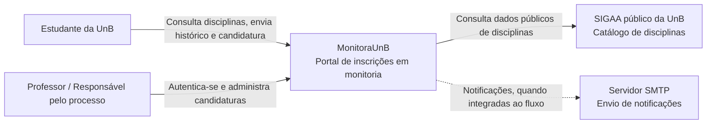

### 3.1 Atores e sistemas externos

| Elemento | Responsabilidade |
|---|---|
| Estudante | Selecionar disciplina, anexar histórico e conferir os dados da candidatura |
| Professor | Acessar área administrativa e, após integração, analisar inscrições e resultados |
| SIGAA público | Fornecer catálogo de componentes curriculares e unidades acadêmicas |
| Servidor SMTP | Transportar mensagens e eventuais anexos gerados pela aplicação |

**Limite de confiança:** o PDF enviado é conteúdo externo e deve ser validado; resultados da coleta pública do SIGAA são dados externos sujeitos a falhas e mudanças de formato.

## 4. C4 — Nível 2: Contêineres

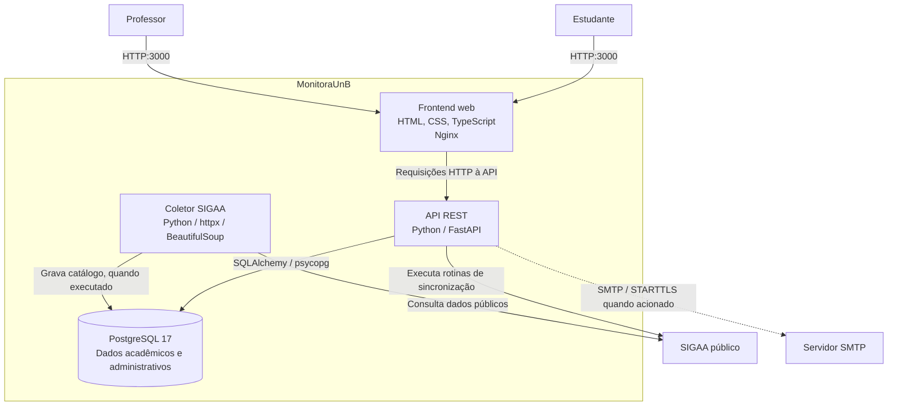

### 4.1 Contêineres e interfaces

| Contêiner | Papel | Interface |
|---|---|---|
| Frontend | Páginas, formulários e renderização da interface | HTTP, porta 3000 publicada em `127.0.0.1` no Compose |
| API | Autenticação, validação de histórico, disciplina, inscrição e serviços de domínio | HTTP, porta 8000 publicada em `127.0.0.1` |
| PostgreSQL | Persistência relacional | Porta interna 5432 na rede Docker |
| Scraping | Execução separada de tarefas de coleta | Serviço Docker do perfil `scraping`; entrada de execução pendente de correção |

**Nota operacional:** no Nginx consultado não há `location /api` configurado. Portanto, a seta frontend → API mostra a comunicação arquitetural necessária, e não um proxy reverso já confirmado. A comunicação precisa usar uma URL acessível ao navegador ou um proxy configurado.

## 5. C4 — Nível 3: Componentes da API

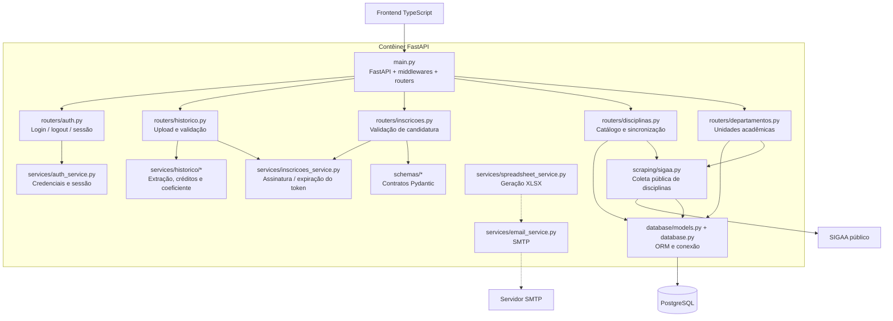

### 5.1 Responsabilidades de componentes

| Componente | Contrato e responsabilidade |
|---|---|
| `main.py` | Inicializa FastAPI, middleware de sessão e CORS e monta rotas com prefixo `/api` |
| `routers/historico.py` | Verifica PDF, matrícula, situação acadêmica, disciplina cursada e elegibilidade; calcula coeficiente e devolve token assinado |
| `services/historico/leiturapdf.py` | Extrai informações básicas do histórico |
| `services/historico/leitura_creditos.py` | Interpreta tabelas, disciplinas e menções |
| `services/historico/calcular_coeficiente.py` | Calcula coeficiente de candidatura com dados validados |
| `services/inscricoes_service.py` | Assina dados acadêmicos e valida assinatura com validade máxima de 900 segundos |
| `routers/inscricoes.py` | Revalida token e condição de aluno ativo; atualmente retorna `status: validada` sem inserir registros |
| `routers/auth.py` e `services/auth_service.py` | Autenticação de professor configurado via ambiente e gerenciamento de sessão |
| `routers/disciplinas.py` e `routers/departamentos.py` | Consultas ao catálogo e disparo de sincronização |
| `scraping/sigaa.py` | Comunicação HTTP e parsing do HTML de resultados do SIGAA |
| `database/database.py` e `models.py` | Engine SQLAlchemy, sessões, entidades de catálogo e log de scraping |
| `services/email_service.py` | Envio de mensagens via SMTP |
| `services/spreadsheet_service.py` | Produção de arquivos Excel `.xlsx` em memória |

## 6. C4 — Nível 4: Código dos principais subsistemas

### 6.1 Processamento do histórico

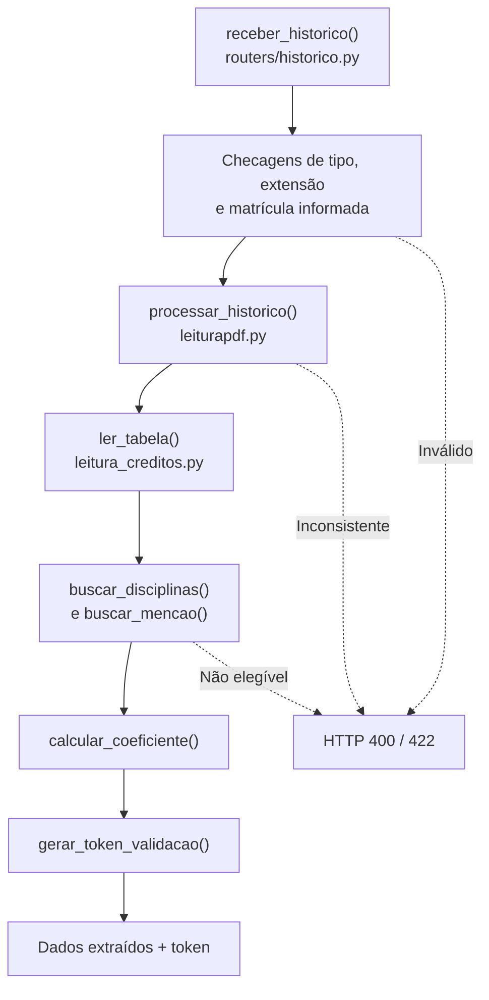

O endpoint verifica `ATIVO`, consistência de matrícula, presença da disciplina e situação de matrícula em andamento. Na seleção da menção, a implementação utiliza o retorno de `buscar_mencao`; a regra efetiva de desempate deve ser conferida nessa função antes de alterar a documentação funcional.

### 6.2 Validação da candidatura

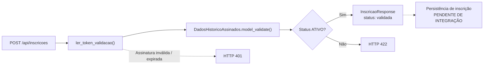

### 6.3 Consulta de disciplinas

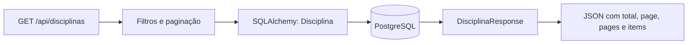

### 6.4 Autenticação

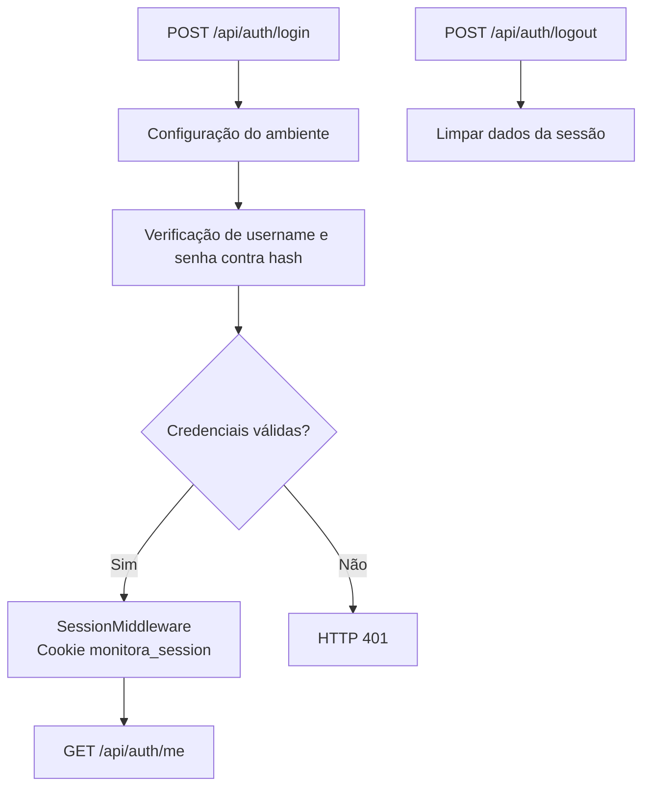

As credenciais do professor do fluxo atual são lidas das variáveis `PROFESSOR_USERNAME` e `PROFESSOR_PASSWORD_HASH`; o modelo `usuario_administrador` do SQL representa outra abordagem ainda não integrada a esse fluxo.

## 7. Arquitetura de dados

### 7.1 Modelo lógico previsto no script SQL

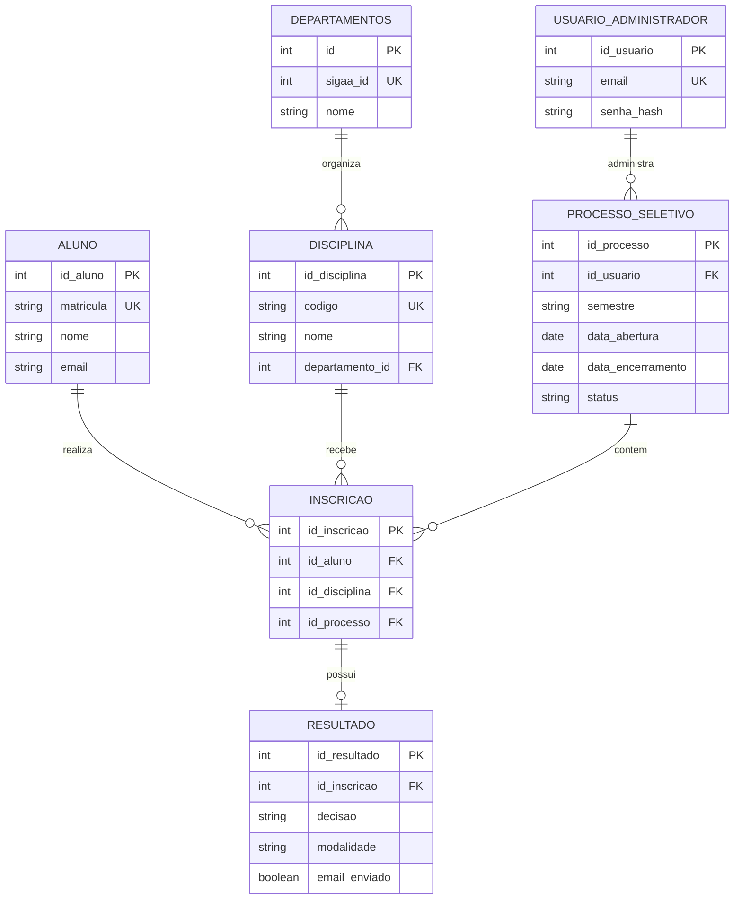

**Atenção:** o desenho mostra os vínculos previstos pelos comandos `ALTER TABLE` de `01_schema.sql`, não garante que o script execute sozinho. Na versão consultada, as restrições de `inscricao` aparecem sem uma instrução `CREATE TABLE public.inscricao` anterior no arquivo. É necessário revisar a ordem/criação completa antes de tratar o DDL como executável.

### 7.2 Persistência presente no ORM

O `backend/database/models.py` consultado declara `Departamento`, `Disciplina` e `ScrapingLog`. A classe `Disciplina` mapeia `__tablename__ = "disciplinas"`, enquanto o DDL SQL declara `public.disciplina` (singular), com coluna de chave primária `id_disciplina` em vez de `id`. **Não se deve assumir que são a mesma tabela.** É preciso escolher uma fonte de verdade e alinhar migrations, modelos, chaves e constraints.

### 7.3 Regras de integridade no DDL

- Matrícula de aluno com nove dígitos, única.
- Um único registro de inscrição por par aluno/processo (`uq_aluno_processo`).
- Processo seletivo com estados `AGENDADO`, `ABERTO` ou `ENCERRADO` e datas coerentes.
- Índice parcial para no máximo um processo `ABERTO` por vez.
- Resultado com decisão `APROVADO` ou `REPROVADO`, modalidade obrigatória para aprovação.
- Triggers previstos para impedir inscrições fora de processo aberto, encerramentos com pendências e mudanças de resultados após envio de e-mail.

Essas restrições dependem da instalação correta do esquema no banco; não devem ser confundidas com validações já expostas em endpoints.

## 8. Arquitetura de implantação

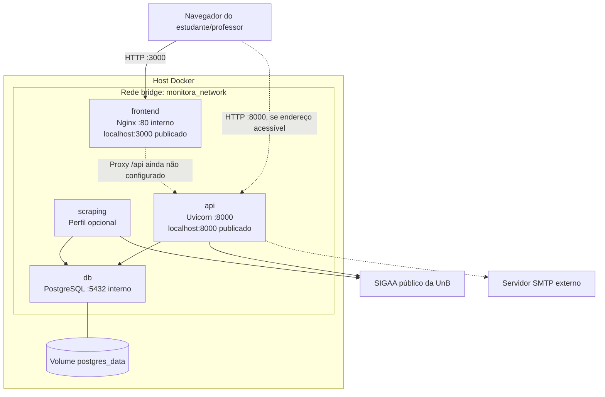

### 8.1 Aspectos operacionais

- `db` usa `postgres:17`, healthcheck com `pg_isready` e volume nomeado `postgres_data`.
- `api` depende de `db` saudável, executa o backend Python e expõe a porta 8000 somente no loopback do host.
- `frontend` compila TypeScript no build e serve estáticos pelo Nginx, porta 3000 no loopback.
- `scraping` pertence ao perfil `scraping` e não inicia por padrão; seu módulo de entrada deve ser corrigido ou criado.
- `SESSION_SECRET`, `PROFESSOR_PASSWORD_HASH` e senha de banco devem ser fornecidos por ambiente seguro.
- Não há TLS público, orquestração de múltiplos nós ou automação de backup demonstrados no Compose consultado. Publicação externa requer configuração adicional.

## 9. Diagramas de sequência

### 9.1 Envio e validação do histórico

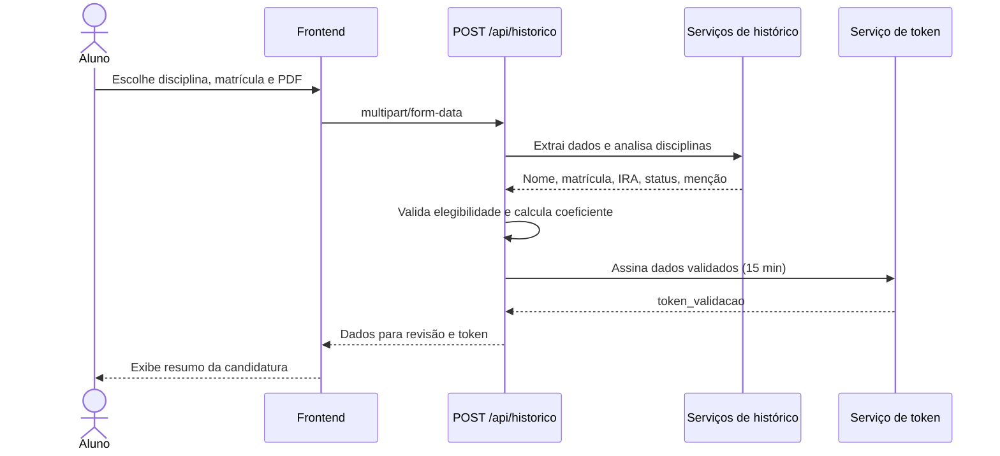

### 9.2 Confirmação da inscrição — comportamento atual

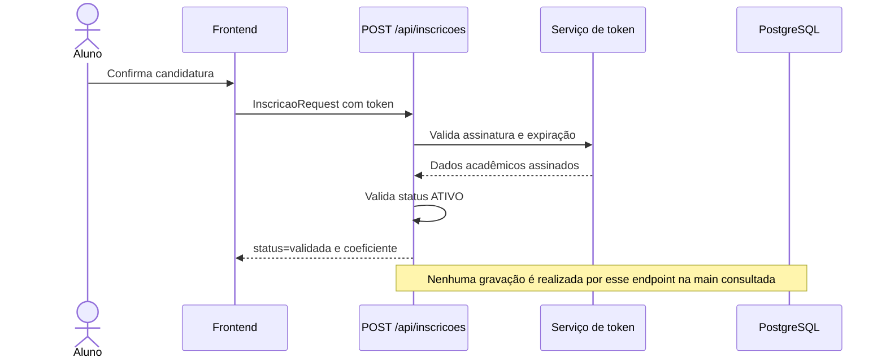

### 9.3 Integração prevista para inscrição persistente

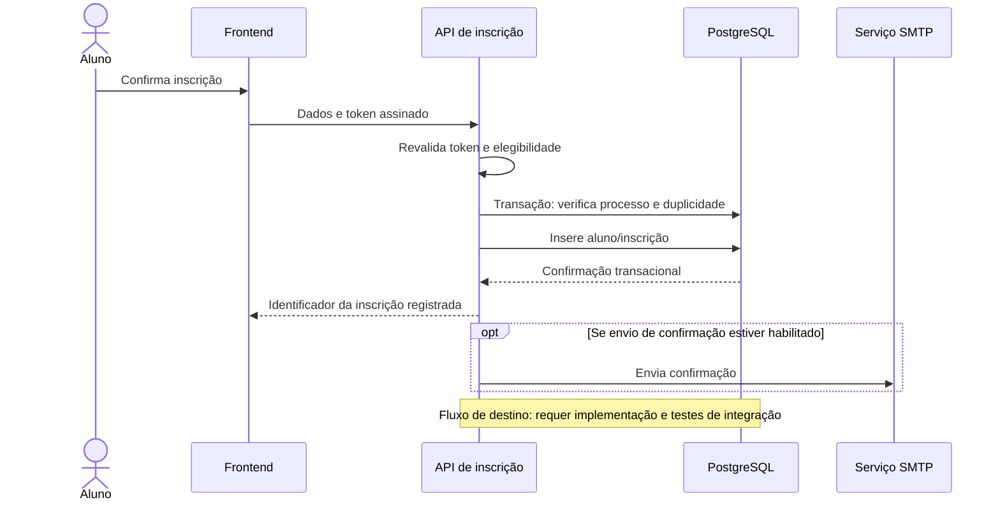

### 9.4 Sincronização do catálogo de disciplinas

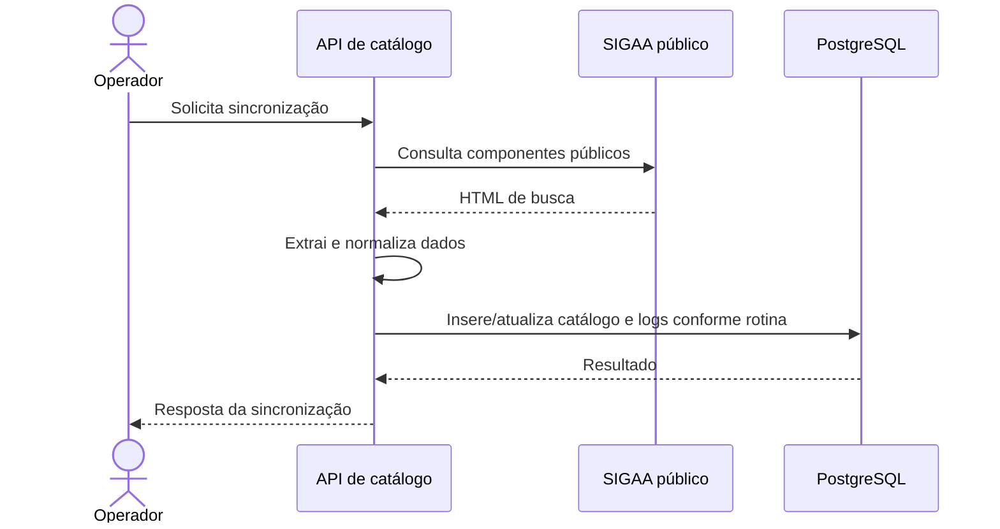

## 10. Requisitos não funcionais e segurança

| Área | Mecanismo atual ou requisito |
|---|---|
| Autenticação | Professor autenticado por hash configurado no ambiente; sessão HTTP |
| Integridade dos dados revisados | `itsdangerous.URLSafeTimedSerializer` e prazo máximo de 15 minutos |
| Validação de entrada | Pydantic; verificação de PDF, matrícula, status acadêmico e disciplina |
| Isolamento de banco | PostgreSQL acessível pela rede Docker, sem porta publicada no host |
| CORS | Configuração atual restrita a `localhost:3000` e `127.0.0.1:3000` |
| Cookies | `same_site=lax`; `https_only=False` no ambiente consultado; deve ser `True` sob HTTPS em produção |
| Segredos | Variáveis do `.env`; nunca versionar credenciais reais |
| Observabilidade | Logging da API; modelo ORM `ScrapingLog` para acompanhar coleta |
| Disponibilidade | Restart `unless-stopped`; healthcheck no banco; demais healthchecks não demonstrados |
| Proteção de dados | Evitar armazenar PDF integral sem necessidade; limitar acesso a dados pessoais e definir retenção |
| Banco de dados | Verificar consistência entre scripts SQL, ORM e persistência real antes de implantação |

**Pontos de segurança a corrigir:** rejeitar `SESSION_SECRET` vazio fora de desenvolvimento; habilitar `Secure` no cookie em HTTPS; garantir CSRF protection conforme desenho de sessão e origem; impor limites de upload no gateway; autenticar/autorizar operações administrativas de sincronização; não expor serviços com credenciais de desenvolvimento; configurar proxy/TLS para implantação pública.

## 11. Decisões arquiteturais

| ID | Decisão | Justificativa |
|---|---|---|
| ADR-01 | Frontend de páginas estáticas + TypeScript | Implantação simples via Nginx e baixo acoplamento com backend |
| ADR-02 | API FastAPI com routers | Separação de endpoints e validações com contratos Pydantic |
| ADR-03 | PostgreSQL para persistência | Relacionamentos e restrições de integridade para processo seletivo |
| ADR-04 | SQLAlchemy para consultas de catálogo | Abstração de acesso a dados e sessões controladas |
| ADR-05 | Token de revisão assinado e temporário | Reduzir adulteração dos dados acadêmicos entre upload e confirmação |
| ADR-06 | Scraping apenas do SIGAA público | Cadastro de disciplinas sem exigir credenciais institucionais |
| ADR-07 | Docker Compose com serviços isolados | Reprodutibilidade do ambiente e separação de responsabilidades |
| ADR-08 | SMTP e geração XLSX como serviços | Reutilização posterior por workflows administrativos |

## 12. Dependências e pendências para a arquitetura-alvo

| Prioridade | Alteração necessária | Critério de conclusão |
|---|---|---|
| Alta | Unificar DDL `disciplina` e ORM `disciplinas`, e conferir tabela `inscricao` | Schema criado sem erro e migrations reprodutíveis |
| Alta | Integrar `POST /api/inscricoes` ao banco | Inserção transacional, checagem de duplicidade e resposta com ID persistido |
| Alta | Substituir dados de exemplo do ranking por consultas reais | Tabela vazia com zero inscrições; lista real quando houver registros |
| Alta | Implementar endpoints administrativos de decisão com autenticação | Aprovar/reprovar persistidos, autorização verificada no servidor |
| Alta | Configurar caminho API para navegador / proxy Nginx | Frontend acessa todos os endpoints sem depender de hostname Docker no browser |
| Alta | Corrigir entrada do serviço scraping em Compose | Serviço executa sem erro de módulo ausente e atualiza catálogo |
| Média | Integrar SMTP ao fluxo de confirmação/decisão | E-mail enviado após commit, falhas registradas e reenvio controlado |
| Média | Integrar geração `.xlsx` a endpoint autorizado | Download com dados reais e controle de acesso |
| Média | Alinhar identidade administrativa SQL vs variáveis de ambiente | Uma estratégia de autenticação claramente definida |
| Média | Testes ponta a ponta + segurança de sessão/CSRF | Casos positivos/negativos automatizados e regressão verificada |
| Média | Estratégia de migração, backup e restore | Restore testado com banco consistente |

## 13. Estrutura de diretórios relevante

```text
2026-2-MonitoraUnB/
├── backend/
│   ├── main.py
│   ├── config.py
│   ├── routers/
│   │   ├── auth.py
│   │   ├── historico.py
│   │   ├── inscricoes.py
│   │   ├── disciplinas.py
│   │   └── departamentos.py
│   ├── services/
│   │   ├── auth_service.py
│   │   ├── inscricoes_service.py
│   │   ├── email_service.py
│   │   ├── spreadsheet_service.py
│   │   └── historico/
│   │       ├── leiturapdf.py
│   │       ├── leitura_creditos.py
│   │       └── calcular_coeficiente.py
│   ├── scraping/
│   │   └── sigaa.py
│   ├── schemas/
│   └── database/
│       ├── database.py
│       ├── models.py
│       └── sql/01_schema.sql
├── front-end/
│   ├── pages/
│   ├── src/pages/
│   ├── src/services/
│   ├── styles/
│   ├── nginx/default.conf
│   └── Dockerfile
└── compose.yaml
```

**Observação:** árvore resumida aos arquivos relevantes vistos na versão consultada, não listagem exaustiva do repositório.

## 14. Rastreabilidade

Esta descrição foi conferida contra os arquivos públicos do repositório `unb-mds/2026-2-MonitoraUnB`, branch `main`, consultados em 22/11/2026: `backend/main.py`, `backend/routers/{auth,historico,inscricoes,disciplinas,departamentos}.py`, `backend/services/{inscricoes_service,email_service,spreadsheet_service}.py`, `backend/scraping/sigaa.py`, `backend/database/{models.py,database.py,sql/01_schema.sql}`, `front-end/src/pages/ranking.ts`, `front-end/nginx/default.conf` e `compose.yaml`.

Como o trabalho segue em branches paralelas, atualize esta documentação após a integração das funcionalidades na branch de publicação. Diagramas marcados como previstos descrevem o destino arquitetural, não o estado operacional atual.
